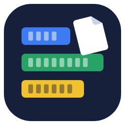
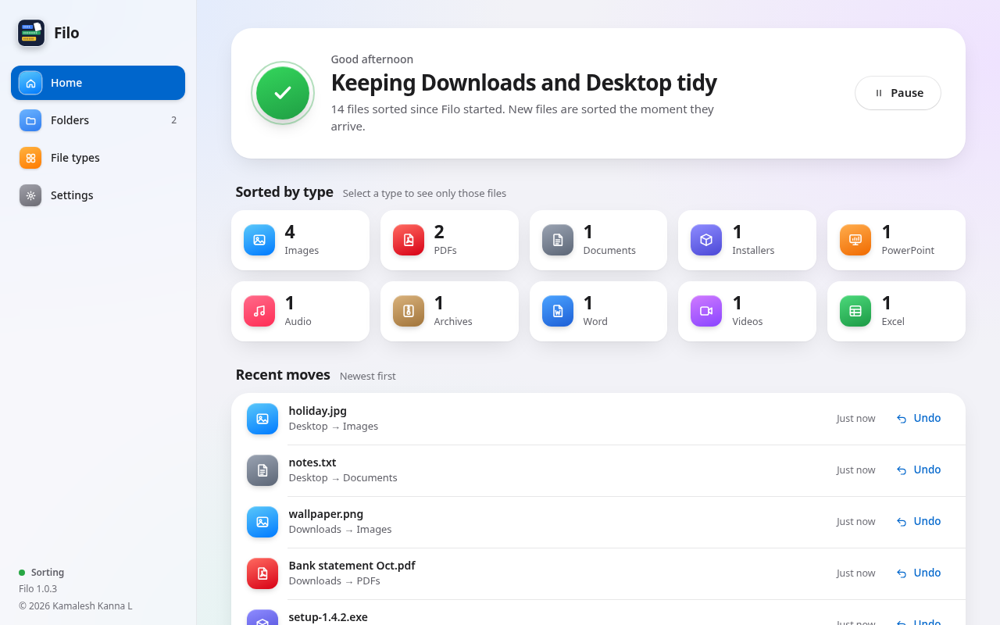
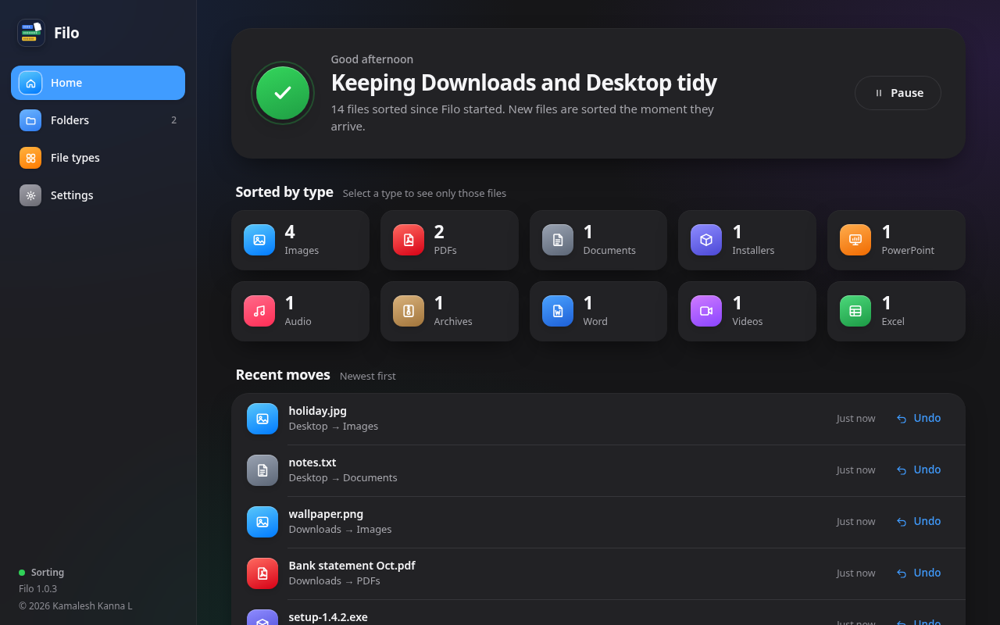
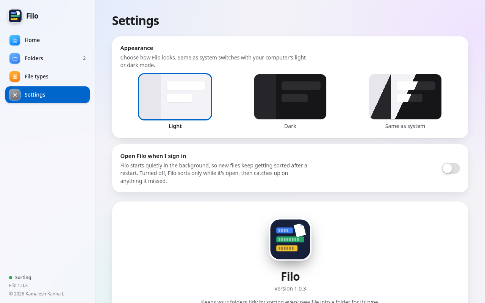

# Filo

Keeps your folders tidy by itself. Choose a folder like Downloads or Desktop,
and every file that lands there is moved straight into a folder for its type:
**Images, Videos, Excel, PDFs, Word, Archives** and more. Filo creates those
folders for you.

  
  &nbsp;
  

## Download

**[Download the latest version](https://github.com/KamaleshKannaL/filo/releases/latest)**: free, for Windows and Linux.

| Your computer | File to download |
|---|---|
| **Windows 10 / 11** | `Filo-…-windows.exe`: double-click to open. No installing, no admin rights. |
| **Linux** (64-bit) | `Filo-…-linux-x86_64.tar.gz`: unpack it, then open `filo` |

On Linux, Filo needs WebKitGTK 4.1 (already on Ubuntu 22.04+, Fedora 37+ and
most current desktops). Keep the program outside the folders Filo watches,
for example in `~/Apps`.

## What it does

- **Instant.** Files are sorted the moment they arrive, and files still
  downloading or being copied are left alone until they're finished.
- **Never overwrites.** If `photo.jpg` is already there, the new one becomes
  `photo (1).jpg`. Every move can be undone.
- **As many folders as you like**, each with its own on/off switch.
  Folders you drop in are left as they are; only loose files are sorted.
- **Your choice of file types.** Rename the folders or change which file
  endings go where. Anything else goes to `Others`, or stays put.
- **Quiet.** Runs in the tray; can open when you sign in.
- **Light and dark mode**, or follow your system.
- **Private.** No account, no internet connection, no tracking
  ([details](SECURITY.md)).

  

## Updating

Download the new version and open it. If Filo is already running, the newer
copy takes over by itself, and your folders and settings carry over.

## Problems or ideas

Open an [issue](https://github.com/KamaleshKannaL/filo/issues).

---

Filo is free to use. © 2026 Kamalesh Kanna L, all rights reserved; see
[LICENSE](LICENSE). Built with the components listed in
[THIRD_PARTY_NOTICES.md](THIRD_PARTY_NOTICES.md).
